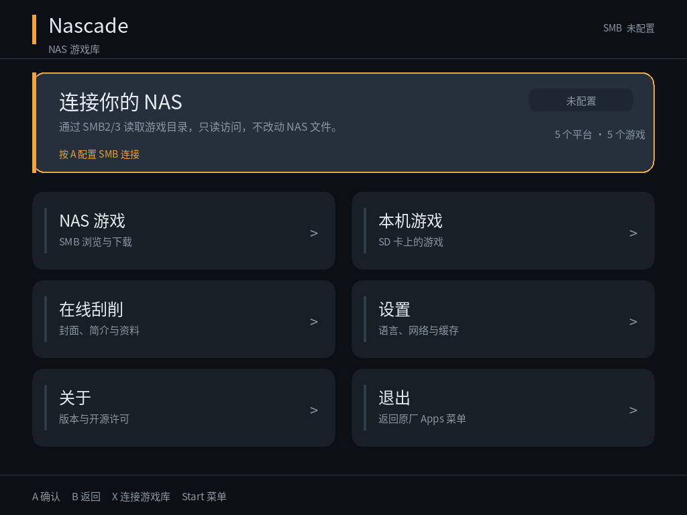
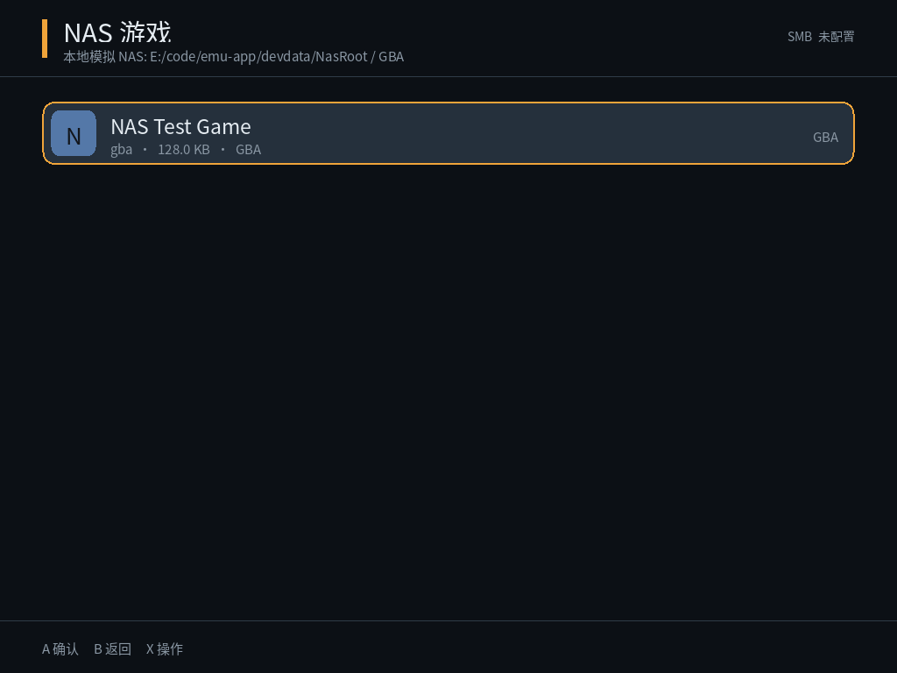

# Nascade

**Nascade = NAS + Arcade + cascade**，运行在 **TrimUI Brick Pro 原厂 TrimUI OS 1.1.1** 上的私有 NAS 游戏库客户端。

仓库：<https://github.com/r0bert001/Nascade>通过 **SMB2/3** 连接家中 NAS，浏览游戏目录与清单，在线刮取封面（可选 ScreenScraper 文字元数据），并把游戏安装到 SD 卡的原厂 `Roms` 目录。

> 当前状态：**M0 技术验证**。桌面 UI、平台扫描、SMB 后端、libretro 封面刮削、ScreenScraper 可选元数据、下载/续传、封面写入已打通；aarch64 目标二进制和原厂 `Apps` 包已交叉编译完成，并在 Brick Pro 真机上验证了启动、SMB2/3 连接、目录浏览和 libretro 封面下载，真实 SMB 完整下载也已通过。剩余主要是断线恢复、认证 UI 和多文件游戏安装。



## 已实现

- SDL2 1024×768 全手柄 UI，简体中文/英文，深色主题，Toast 和页面导航。
- 扫描 `Emus/*/config.json`，自动发现平台、`rompath`、`imgpath`、`extlist`。
- 本地游戏递归扫描子目录（FC/SFC/GB/MD/WS 等按分类存放的库也能完整列出）；在配置 `extlist` 基础上补充常见格式（如 ATARI2600 的 `.7z`、NDS 的 `.nds`、PICO8 的 `.p8`、PPSSPP 的 `.iso`、DC 的 `.zip`），FC/SFC 支持无后缀 ROM，并过滤 `.db`、`.srm`、文档和多碟 `.bin/.cue` 重复项。
- 本地游戏清单、游戏详情、设置、日志导出。
- 本地游戏详情支持“删除游戏”（红色按钮），删除前弹出确认框：方向键在“删除游戏/取消”之间选择，A 执行当前选项，B 直接关闭确认框；默认选中“取消”。会删除主文件及同目录同名的 cue/bin 常见附属文件，删除后返回游戏列表并提示刷新原厂菜单。
- 按钮文字按实际字体纹理高度垂直居中（详情、设置、刮削、SMB、日志和确认框等按钮），修正文字偏下的问题。
- 顶栏主标题与副标题之间增加间距，避免两行文字贴在一起。
- NAS 连接失败页面明确显示“A 重试 / B 返回”；按 A（或 X）会丢弃旧会话并重新建立连接，重试期间显示“正在连接 NAS…”。
- 首页下载状态卡片左侧显示正在下载游戏的封面：优先使用刮削/`Imgs` 中的图片，无封面时显示游戏名首字占位；下载过程中完成刮削也会刷新卡片封面。
- 详情页顶栏只显示“游戏详情”，不再重复游戏名；平台/格式/已安装标签文字按实际字体高度垂直居中。
- 下载进度和下载状态按游戏隔离：打开其他游戏详情时不会显示正在下载游戏的进度条、完成状态或“下载中”按钮；刮削状态同样只显示在对应游戏详情页。
- 游戏列表、平台列表和 NAS 列表支持长按上下键快速滚动：按住 350ms 后开始重复，先约 80ms/次，持续 1.2s 后加速到约 40ms/次。
- NAS 目录浏览：目录/文件列表、平台识别、远程游戏详情；已在真机通过真实 SMB 共享验证连接与列目录。
- SMB2/3 后端（libsmb2）：连接、列目录、`stat`、按偏移读取；已在真机对 Samba 共享验证连接与列目录，并通过目标二进制从真实 SMB 完整下载 32MB NDS 文件，断点续传/断线恢复待验证。
- 下载到 SD：`.part` 临时文件、断点续传、完成后重命名；收尾时先关闭 SMB 文件句柄再销毁会话，避免析构顺序错误导致卡在“正在完成安装”。已用本地模拟 NAS 做端到端验证。
- 退出保护：关闭应用时不再同步等待未完成的 SMB/刮削/下载任务，网络卡住时也能正常返回原厂菜单。
- 首页状态卡片：未连接时显示 NAS 连接提示；已连接且正在下载时显示游戏名、进度条、已下载/总大小和百分比；已连接空闲时只显示“本地游戏库”和平台/游戏统计，不再显示服务器地址、连接徽标或 SMB 操作提示。SMB 配置完整时首页直接显示本地库统计，并在后台预连接。首页按 X 打开 SMB 连接页；已连接状态下聚焦这张卡片按 A 不再跳转 SMB。
- SMB 连接健康检查：每秒检查已建立连接的 socket；服务器关闭导致连接断开时释放会话，顶栏状态从“已连接”回落到“未连接”，并提示“NAS 连接已断开”。顶栏不再显示“已配置”，而是显示当前连接状态：已连接/连接中/未连接/未配置。
- **libretro 封面刮削（默认）**：从 `thumbnails.libretro.com` 的 `Named_Boxarts` 抓取封面。按平台读取 zip/裸 ROM 内部标题（GB/GBC/GBA/SFC/MD/N64），做归一化模糊匹配和文件名回退，支持区域偏好和别名；封面下载后写入 `Imgs/<SYSTEM>/<romname>.png`。该源只提供图片，不含简介、开发商等文字。
- **ScreenScraper（可选）**：保留原数据源，可把 `scraper.provider` 设为 `screenscraper`，获取标题/简介/开发商/发行商/发售日/类型/人数/评分，`zh` 优先、`en` 回退。
- 封面下载、详情页显示；同时生成约 300px 的 PNG 写入 `Imgs/<SYSTEM>/<romname>.png`，供原厂游戏菜单使用。本机和 NAS 游戏详情都会优先读取 `Imgs/<SYSTEM>/` 的封面，ROM 名带 `(USA)`、`[简]` 等标签时也会按去标签标题匹配。
- 原厂 1.1.1 格式的 `Apps/Nascade.pak` 包：`label.ch.lang`、`icontop` 300×300、启动脚本、字体、CA、SDL2/C++ 运行库。
- 官方 TrimUI SDK aarch64 交叉编译；qemu-user 下已通过启动、下载/续传、libretro 匹配、ScreenScraper/JSON 冒烟测试。
- PPM/PNG 截图工具，便于无真机时检查 UI。



## 尚未完成

- 下载/网络任务进行中退出应用的完整回归（退出保护已实现并部署，待真机实测）。
- UI 内的 SMB 账号/密码编辑（目前首次运行自动生成 `.Nascade/config.json`，在电脑上编辑）。
- 多文件游戏（`.cue`+`.bin`、`.m3u`、多碟）整组下载；暂停/取消/队列/并发/空间预检。
- 元数据 SQLite 持久化（当前标题/简介只在本次运行内保存；封面已写入 `Imgs`）。
- 批量刮削、刮削配额管理、手动匹配修正。
- 安装后刷新原厂游戏菜单、已安装库管理、更新检测。
- 真实 NAS 上的 SMB 断点续传/断线恢复（完整下载已验证）。

## 桌面构建（Windows + MSYS2）

本仓库当前使用的开发环境：

- 便携 MSYS2：由 `MSYS2_ROOT` 指定
- libsmb2 源码/构建：由 `LIBSMB2_SRC`、`LIBSMB2_BUILD` 指定
- 依赖：`mingw-w64-x86_64-gcc`、`cmake`、`ninja`、`SDL2`、`SDL2_ttf`、`libcurl`、`sqlite3`、`zlib`

```sh
./scripts/fetch_assets.sh
MSYS2_ROOT=/path/to/msys64 \
LIBSMB2_SRC=/path/to/libsmb2_src \
LIBSMB2_BUILD=/path/to/libsmb2_build \
./scripts/build_desktop_msys2.sh
```

不启用 SMB 的纯桌面构建：

```sh
cmake -S . -B build/desktop -G Ninja -DCMAKE_BUILD_TYPE=Debug
cmake --build build/desktop
```

### 运行

```sh
python scripts/make_devdata.py
export NASCADE_SD_ROOT="$PWD/devdata"
./build/mingw/bin/nascade.exe
```

`devdata/` 是本地生成的模拟 SD 卡，包含模拟 `Emus`、占位 `Roms` 和零填充下载测试文件，**不包含真实游戏 ROM，也不纳入版本控制**。

### 截图

```sh
./build/mingw/bin/nascade.exe --screenshot screenshots/home.ppm --screen home
python tools/ppm_to_png.py screenshots/home.ppm screenshots/home.png
```

可用页面：`home`、`home-connected`、`home-downloading`、`platforms`、`games`、`detail`、`settings`、`about`、`smb`、`scraper`、`logs`、`remote`。`home-connected` 需要设置 `NASCADE_LOCAL_NAS` 才有本地连接状态；`home-downloading` 是固定的 35% 示例进度。

`remote` 页面默认需要连接 SMB；无 NAS 时可用本地目录模拟：

```sh
export NASCADE_LOCAL_NAS="$PWD/devdata/NasRoot"
export NASCADE_REMOTE_DIR=GBA
./build/mingw/bin/nascade.exe --screenshot screenshots/remote.ppm --screen remote
```

### M0 自测命令

先生成本地模拟数据：

```sh
python scripts/make_devdata.py
```

```sh
# 本地模拟 NAS 的远程浏览 + 下载 + 续传
export NASCADE_SD_ROOT="$PWD/devdata"
export NASCADE_LOCAL_NAS="$PWD/devdata/NasRoot"
export NASCADE_REMOTE_DIR=GBA
export NASCADE_REMOTE_FILE='NAS Test Game.gba'
./build/mingw/bin/nascade.exe --test-ui-download

# 本地模拟 ScreenScraper：元数据 + 封面下载 + 写入 Imgs
python tools/mock_screenscraper.py 8765
export NASCADE_SS_DEVID=test
export NASCADE_SS_DEVPASSWORD=test
export NASCADE_SS_BASEURL=http://127.0.0.1:8765
./build/mingw/bin/nascade.exe --test-ui-scrape
```

`--test-ui-scrape` 会在 `devdata/Imgs/GBA/` 下生成约 300px 的 PNG 封面；随后用 `--screen detail` 截图可以看到封面。

libretro 封面刮削测试（默认数据源，不需要凭据）：

```sh
export NASCADE_SCRAPER_PROVIDER=libretro
./build/mingw/bin/nascade.exe --test-scraper
./build/mingw/bin/nascade.exe --test-scrape

# 用真实本地 ROM 测试内部标题匹配（文件不入库，请换成自己的路径）
export NASCADE_SCRAPE_FILE='/path/to/game.zip'
export NASCADE_SCRAPE_PLATFORM=GBA
./build/mingw/bin/nascade.exe --test-scrape
```

## SMB 配置

M0 暂不提供 UI 凭据编辑。桌面测试可写 `.Nascade/config.json`，或使用环境变量 + 命令行测试：

```sh
export NASCADE_SMB_HOST=192.168.1.10
export NASCADE_SMB_SHARE=retro
export NASCADE_SMB_ROOT=/roms
export NASCADE_SMB_USER=nascade
export NASCADE_SMB_PASSWORD='***'
./build/mingw/bin/nascade.exe --test-smb
```

应用内的“SMB 连接 → 测试连接”会读取 `config.json`，也支持上述环境变量。成功后会显示共享根目录的条目数量。

```json
{
  "smb": {
    "name": "我的 NAS",
    "host": "192.168.1.10",
    "port": 445,
    "share": "retro",
    "root": "/roms",
    "username": "nascade",
    "password": "***",
    "domain": "",
    "savePassword": true
  }
}
```

> 建议在 NAS 上使用只读、最小权限专用账号；SD 卡上的密码没有可靠的系统级保护。

## 刮削配置

默认使用 **libretro thumbnails**，不需要账号或 API 凭据：

```json
{
  "scraper": {
    "enabled": true,
    "provider": "libretro",
    "baseUrl": "https://thumbnails.libretro.com",
    "region": "cn"
  }
}
```

- 封面按平台从 `Named_Boxarts` 获取；`region` 控制区域偏好，`cn` 在 libretro 下按美版/欧版优先。
- GB/GBC/GBA/SFC/MD/N64 会从 ROM（含 zip 内第一个 ROM）读取内部标题；其他平台退回文件名。
- 中文 ROM 文件名且没有可读内部标题时可能匹配不到；可改成英文文件名或使用 ScreenScraper。
- 抓取到的封面会缩放到约 300px 并写入 `Imgs/<SYSTEM>/<romname>.png`，同时用于详情页显示。
- 封面列表缓存到 `.Nascade/cache/libretro/`，默认 7 天刷新一次。

### 可选：ScreenScraper

ScreenScraper 需要开发者凭据 `devid` / `devpassword`，普通账号 `ssid` / `sspassword` 可选但强烈建议，以提高配额。应用不内置任何凭据。把 `scraper.provider` 改为 `screenscraper`，并填写凭据后，可获取标题、简介、开发商、发行商、发售日、类型、人数和评分。

桌面测试：

```sh
export NASCADE_SCRAPER_PROVIDER=screenscraper
export NASCADE_SS_DEVID=...
export NASCADE_SS_DEVPASSWORD=...
export NASCADE_SS_SSID=...
export NASCADE_SS_SSPASSWORD=...
./build/mingw/bin/nascade.exe --test-scraper
./build/mingw/bin/nascade.exe --test-scrape
```

无真实凭据时，可用本地模拟服务验证 HTTP/JSON 链路：

```sh
python tools/mock_screenscraper.py 8765
export NASCADE_SCRAPER_PROVIDER=screenscraper
export NASCADE_SS_DEVID=test
export NASCADE_SS_DEVPASSWORD=test
export NASCADE_SS_BASEURL=http://127.0.0.1:8765
./build/mingw/bin/nascade.exe --test-scraper
./build/mingw/bin/nascade.exe --test-scrape
```

应用内“在线刮削”页面可以测试当前数据源；游戏详情页的“在线刮削”会在后台执行。

> ScreenScraper 的中文资料覆盖不完整。请求 `langue=zh`，缺失时回退 `en`；后续可接入 Bangumi 等中文补充源。

## 目标构建与安装包

已使用官方 TrimUI SDK（20231018）+ WSL1 Ubuntu 完成 aarch64 交叉编译。

- 构建产物：`build/Nascade.pak.zip` 和 `dist/Nascade.pak.zip`（约 17MB，不入库）
- 构建目录：`build/tg5040/`
- 工具链：`/opt/tg5040/toolchain`（Linaro GCC 7.5）
- SDK sysroot：`/opt/tg5040/sysroot`
- 交叉依赖：`/opt/tg5040/deps`（静态 libcurl + OpenSSL 1.1、libsmb2；SQLite 使用 SDK 静态库）

> 这台机器 BIOS 未开启 VT-x，WSL2 无法启动；实际用 WSL1 完成了编译。交叉编译不依赖 WSL2。如果以后要在 BIOS 打开 VT-x/AMD-V，可执行 `wsl --shutdown` 后 `wsl --set-version UbuntuBuild1 2` 切到 WSL2。

构建脚本（在仓库根目录、WSL1 的 root 下执行）：

```sh
wsl -d UbuntuBuild1 -u root -- bash scripts/wsl_bootstrap.sh      # 仅首次
wsl -d UbuntuBuild1 -u root -- bash scripts/wsl_extract_sdk.sh    # 仅首次
wsl -d UbuntuBuild1 -u root -- bash scripts/wsl_build_deps.sh     # 仅首次
wsl -d UbuntuBuild1 -u root -- bash scripts/wsl_build_app.sh
wsl -d UbuntuBuild1 -u root -- bash scripts/wsl_repack_safe.sh
```

首次构建前需要准备：

- `SDK_DOWNLOAD_DIR`：存放官方 SDK、Linaro 工具链和 SDL2 源码包
- `LIBSMB2_SRC`：libsmb2 源码目录
- `CURL_ARCHIVE`：libcurl 源码压缩包

这些变量需要在 WSL 内设置，或在脚本开头修改默认值；Windows 环境变量不会自动传入 WSL。

### 安装到 Brick Pro

1. 解压 `dist/Nascade.pak.zip`，得到 `Nascade.pak/`。
2. 把整个目录放到 SD 卡 `Apps/` 下：`/mnt/SDCARD/Apps/Nascade.pak/`。
3. 重启 Brick Pro，原厂 Apps 菜单中会出现“Nascade”（对应菜单配置里的 `label.ch.lang`；如果菜单未显示，需要在 `Apps/show.json` 中加入“Nascade”条目）。
4. 首次运行后编辑 `/mnt/SDCARD/.Nascade/config.json`，填写 SMB；刮削默认使用 libretro，无需凭据。包内 `config.example.json` 是模板。
5. 进入应用“SMB 连接 → 测试连接”，再进入“NAS 游戏”浏览和下载。

### 已做过的目标验证

- `file`：aarch64 ELF，解释器 `/lib/ld-linux-aarch64.so.1`
- `readelf -d`：需要 `libSDL2-2.0.so.0`、`libSDL2_ttf-2.0.so.0`、`libfreetype.so.6`、`libstdc++.so.6`、`libgcc_s.so.1`、`libz.so.1` 等；这些已随包放入 `lib/`
- qemu-aarch64 下通过：`--help`、`--test-download`（SHA1 一致）、`--test-scraper`、`--test-scrape`
- qemu + SDL `offscreen` 驱动渲染 1024×768 首页成功，包内 Noto 字体和 SDL2/SDL2_ttf 正常：`docs/images/target_home.png`
- **真机（SSH，原厂 1.1.1）**：glibc 2.33；系统 SDL2 2.30.8 / SDL2_ttf 2.14.1 位于 `/usr/trimui/lib`；包内二进制 `--help` 通过，本地下载 MD5 一致，offscreen 渲染扫描到 38 个平台 / 3972 个游戏。
- 真机通过 SMB2/3 连接 Samba 共享成功，应用 `--test-smb` 在 `/Roms` 下列出 1 个文件；同时修正了 libsmb2 共享内相对路径不能带前导 `/` 的问题。
- 已安装到 `/mnt/SDCARD/Apps/Nascade.pak/`，菜单标签“Nascade”；安装后 SD 剩余约 525MB。
- Brick Pro 物理 A/B、X/Y 与 SDL 逻辑按键相反；已在 `Input` 中交换：物理 A = 确认，物理 B = 返回，物理 X = 选项（首页“连接游戏库”），物理 Y = Alt。
- `launch.sh` 优先使用原厂 `/usr/trimui/lib` 的 SDL2/SDL2_ttf，包内 `lib/` 作为回退。
- 应用已在真机通过 Apps 菜单启动，SDL 全屏、中文字体和手柄导航均可实际使用；A/B 映射和首页焦点问题已根据反馈修正并部署。

真机待验证：SMB 断点续传/断线恢复、ScreenScraper 可选数据源、下载中退出应用。真实 SMB 完整下载和 libretro 封面连接/匹配/写入已验证。

## 目录结构

```text
src/
├── app/         应用状态机与页面
├── core/        路径、配置、日志、国际化、工具
├── model/       Platform / Game
├── scan/        Emus 平台扫描、本地游戏扫描
├── scrape/      HTTP、libretro、ScreenScraper
├── storage/     SQLite
├── ui/          SDL2 渲染、字体缓存、输入
└── vfs/         VFS 接口、本地后端、SMB 后端
docs/            需求清单与截图
packaging/       原厂 Apps 包模板
scripts/         构建、资源下载、打包
tools/           图标、PPM→PNG、ScreenScraper 模拟服务（可选）
devdata/         本地生成的模拟 SD 卡（不入库）
```

## 后续计划

1. **稳定性**：断点续传/断线恢复、下载中退出的完整回归。
2. **安装体验**：UI 内 SMB 凭据编辑、多文件游戏整组下载、安装后刷新原厂游戏菜单。
3. **刮削**：元数据 SQLite 持久化、批量刮削、手动匹配修正。
4. **M2**：已安装库管理、更新检测、更多元数据源、Stock OS 兼容性打磨。

## 合规与许可

- 本项目不提供、不内置、不索引任何游戏 ROM 或 BIOS。
- 请只访问你拥有合法使用权的游戏文件，并遵守 NAS 与刮削服务的条款。
- 代码许可证待定（建议 GPL-3.0，便于与 LGPL 的 libsmb2/libnfs 等库组合）；第三方组件许可见各自项目。
